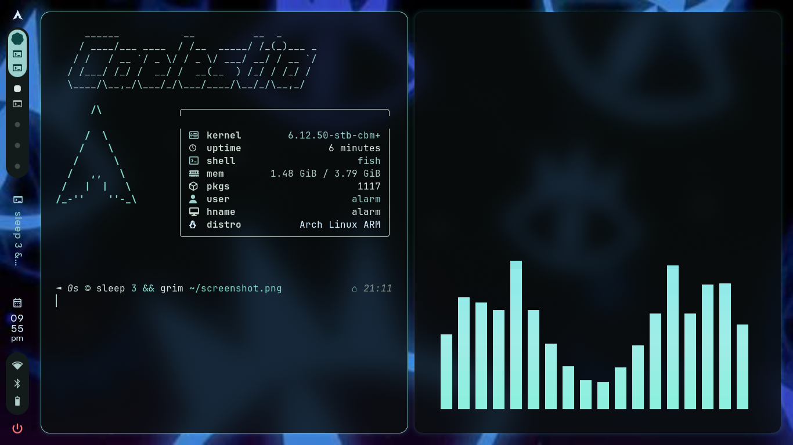

# Arch Linux ARM + Hyprland (Caelestia) on an HP Chromebook

A lightweight, Wayland-native desktop setup and hardware-fix guide for running **Arch Linux ARM** with **Hyprland** and the **Caelestia** shell on a 4GB ARM64 HP Chromebook.


<!-- Replace with a screenshot of your finished desktop -->

---

## System Specs & Stack

| Component | Details |
| :--- | :--- |
| **Device** | HP Chromebook (ARM64) |
| **Memory** | 4 GB RAM (~3.79 GiB usable) |
| **OS** | Arch Linux ARM |
| **Kernel** | `6.12.50-stb-cbm+` |
| **Compositor / Shell** | Hyprland + Caelestia (Lua config) |
| **Terminal / Shell** | `foot` + `fish` |
| **Audio** | PipeWire + WirePlumber |

---

## Hardware & Compatibility Fixes

### 1. Audio Routing (WirePlumber)
Chromebook ARM64 audio requires selecting the correct WirePlumber profile for the internal sound card so audio routes properly to speakers/headphones.

### 2. Top-Row Media Keys (Caelestia Lua Keybinds)
Caelestia loads its Hyprland configuration via Lua (`~/.config/hypr/hyprland/keybinds.lua`) rather than a standard `hyprland.conf`. Because Chromebook top-row keys send `F6`–`F10` instead of `XF86` media codes, they can be mapped directly alongside the default binds:

```fish
cp ~/.config/hypr/hyprland/keybinds.lua ~/.config/hypr/hyprland/keybinds.lua.bak

# Map F8 (Mute), F9 (Volume Down), F10 (Volume Up)
sed -i 's/"XF86AudioMute" }/"XF86AudioMute", "F8" }/; s/"XF86AudioRaiseVolume",/{ "XF86AudioRaiseVolume", "F10" },/; s/"XF86AudioLowerVolume",/{ "XF86AudioLowerVolume", "F9" },/' ~/.config/hypr/hyprland/keybinds.lua

# Optional: Map F6 (Brightness Down) and F7 (Brightness Up)
sed -i 's/"XF86MonBrightnessDown",/{ "XF86MonBrightnessDown", "F6" },/; s/"XF86MonBrightnessUp",/{ "XF86MonBrightnessUp", "F7" },/' ~/.config/hypr/hyprland/keybinds.lua

hyprctl reload
